# Orchestrating Delivery Agents

## Overview

Long delivery jobs (a whole roadmap, a migration, a multi-epic feature) outlive any single agent's
context window. Instead of one agent that runs out of context and gets restarted by hand, you act as a
**pure orchestrator**: you never execute the work yourself — you spawn a sequence of fresh **worker
agents**, each doing one context-bounded chunk, and you chain them through **handoff files**.

**Core principle: the orchestrator stays lean and keeps its own state ON DISK, so it can outlive every
worker — and survive its own compaction or restart.** You relay handoff paths and compact reports; you
do not read heavy files (handoff bodies, source, agent transcripts). Workers hold the detail; a small
on-disk ledger holds the thread.

Three roles:
- **Orchestrator (you):** spawns workers, monitors them, chains cycles, decides forks, talks to the human, keeps the on-disk state file. Executes nothing.
- **Cycle-worker:** a fresh agent that does ONE chunk until ~75–80% of its context, then writes a handoff and reports. Disposable by design.
- **Handoff:** the memory baton between workers — a self-contained doc a fresh worker reads to resume with zero prior context.

**Capability check (do this first):** which spawning surface do you have?
- **Agent Teams** (workers in **tmux split panes**, live two-way `SendMessage`) — best when a human watches and you steer mid-cycle.
- **Background subagents** (run-to-completion `/workflows` tasks, killed with `TaskStop`) — works headless with no live nudging; some live-monitoring edge cases below don't apply.
Pick per environment; the protocol below marks where the two differ.

## When to use / not

Use for: work that exceeds one agent's context; an agent you keep restarting on context exhaustion;
a human who wants to watch and steer; resuming a broken/abandoned chain.
**Not** for: a single bounded task (just do it / one subagent); pure fan-out with no sequential
dependency (use a Workflow — see `superpowers:dispatching-parallel-agents`).

## The lifecycle decision that keeps the chain stable

The two ways orchestration breaks are **spawning a duplicate** (two workers → double-merge) and
**killing a productive worker** (its report was just slow). Both come from misreading "idle". This is
where you go wrong if you go fast:

```dot
digraph idle {
  "Worker idle, no report" [shape=box];
  "Report arrived (in-flight)?" [shape=diamond];
  "Handle report; if done: terminate -> CONFIRM -> chain next" [shape=box];
  "Liveness: report? /workflows done? pane alive? git moved?" [shape=diamond];
  "Alive/moving -> WAIT (idle between turns is normal)" [shape=box];
  "No git progress ~10-15m OR no report ~45-60m?" [shape=diamond];
  "Keep waiting; re-check on a timer" [shape=box];
  "Already nudged this stall?" [shape=diamond];
  "ONE nudge: send PROGRESS or finalize (do NOT also spawn a duplicate)" [shape=box];
  "Safe to kill? (no uncommitted SOURCE: git status --porcelain)" [shape=diamond];
  "Hard-kill per surface -> CONFIRM -> fresh cycle rebuilds from git" [shape=box];
  "Directive nudge: commit-or-revert WIP + approve shutdown in N min" [shape=box];
  "Now clean / responsive?" [shape=diamond];
  "BLOCKED_ON_HUMAN (AskUserQuestion: discard WIP+kill vs keep waiting)" [shape=box];

  "Worker idle, no report" -> "Report arrived (in-flight)?";
  "Report arrived (in-flight)?" -> "Handle report; if done: terminate -> CONFIRM -> chain next" [label="yes"];
  "Report arrived (in-flight)?" -> "Liveness: report? /workflows done? pane alive? git moved?" [label="no"];
  "Liveness: report? /workflows done? pane alive? git moved?" -> "Alive/moving -> WAIT (idle between turns is normal)" [label="alive"];
  "Liveness: report? /workflows done? pane alive? git moved?" -> "No git progress ~10-15m OR no report ~45-60m?" [label="static"];
  "No git progress ~10-15m OR no report ~45-60m?" -> "Keep waiting; re-check on a timer" [label="no"];
  "No git progress ~10-15m OR no report ~45-60m?" -> "Already nudged this stall?" [label="yes"];
  "Already nudged this stall?" -> "ONE nudge: send PROGRESS or finalize (do NOT also spawn a duplicate)" [label="no"];
  "Already nudged this stall?" -> "Safe to kill? (no uncommitted SOURCE: git status --porcelain)" [label="yes"];
  "Safe to kill? (no uncommitted SOURCE: git status --porcelain)" -> "Hard-kill per surface -> CONFIRM -> fresh cycle rebuilds from git" [label="yes"];
  "Safe to kill? (no uncommitted SOURCE: git status --porcelain)" -> "Directive nudge: commit-or-revert WIP + approve shutdown in N min" [label="no (dirty source)"];
  "Directive nudge: commit-or-revert WIP + approve shutdown in N min" -> "Now clean / responsive?";
  "Now clean / responsive?" -> "Hard-kill per surface -> CONFIRM -> fresh cycle rebuilds from git" [label="clean"];
  "Now clean / responsive?" -> "BLOCKED_ON_HUMAN (AskUserQuestion: discard WIP+kill vs keep waiting)" [label="still stuck"];
}
```

**Iron rule of chaining: confirm the prior worker is TERMINATED before spawning the next cycle.**
Spawning a replacement while the original is alive is the #1 cause of duplicate/destructive work.
**Never let one worker stall the pipeline forever** — the escape hatch above (nudge → directive nudge →
human) always terminates.

## Spawning a cycle worker

- Use a worker type that has `SendMessage` (e.g. general-purpose). A read-only / no-SendMessage type cannot report — have it `Bash`-write findings to a known file you Read.
- **Least privilege:** give each cycle the minimum tools it needs; do NOT run unattended workers with sandbox disabled / permissions bypassed beyond what the task requires.
- Give a self-sufficient brief — see `references/worker-cycle-template.md`. Spawn mechanics per surface and a background-only loop are in `references/lifecycle-and-edge-cases.md`.
- One worker per working tree (see Concurrency). For cycle #1 on a NEW project, see "Starting from zero".

## Monitoring without burning your context

- Signals: `SendMessage` reports (real) and idle notifications (turn boundaries — NOT a stop/finish signal).
- **Liveness, ranked (highest first):** a report = reached a boundary; a `/workflows` task in terminal state = exited; `tmux list-panes -F '#{pane_id} #{pane_dead}'` = running vs exited; git movement = proves *progress*, never proves *stopped*. Before concluding "stuck", check non-git evidence too (`tmux capture-pane -p | tail`, build/log mtime).
- **Probe read-only and OFF the worker's tree:** `git fetch --quiet` first, then `git log origin/main..origin/<branch> --oneline`; treat `gh pr view <n> --json state,mergedAt` as the authoritative done-signal (local `main` does NOT advance on a remote merge). Use `gh`, `git ls-remote`, or `git -C <path>` — don't run `git status` against a live worker's tree (its branch switch would misreport your view). **Never read the worker's transcript** (context overflow).
- **Two patience clocks:** kill-timer arms on (a) no git progress ~10–15 min AND also (b) no report for a hard ceiling ~45–60 min *regardless of git movement* (a looping worker commits forever — git motion ≠ health). Require workers to `SendMessage` a one-line `PROGRESS` before any long (>~10 min) no-commit step, and key patience on last-known-liveness, not time-since-spawn.
- **Verification watchdog (refines the coarse ~20-min clock for any verification step).** A declared
  verification step — run by an orchestrator-spawned verifier-teammate (the live-validated default for
  user-facing surfaces) or a worker-owned background subagent — is the one place that coarse silence clock
  is too slow, and prompt-level time caps do NOT self-enforce (observed: a "10-min cap" written into a
  verifier's prompt ran 33 min). So arm an EXTERNAL watchdog: a background watcher polling the verifier's
  `steps.log` heartbeat every ~20s. ~3 min of silence → wake and intervene, FIRST killing the automation
  browser (the gentle unstick — it errors the frozen step so the turn ends and steering resumes; pane-kill
  the verifier itself only if it stays stuck). ~15 min total → cap reached, take the PARTIAL report. The
  journal's last `START` line pinpoints the frozen step. Identify hung automation processes by their flags
  (e.g. `--allow-pre-commit-input`) + recent start time — NEVER the human's own browser. See edge case E17
  in `references/lifecycle-and-edge-cases.md`.
- **Stay lean:** don't probe on every idle — probe on a timer (stall start, then ~5 min) or a `Monitor` poll loop; keep probes terse and compare a stored SHA in the state file; log nothing on no-change.

## Terminating + chaining

1. **Prefer self-quiescence:** brief workers to finish → write handoff → `SendMessage` report → go idle. A clean COMPLETE report is your terminate signal; you needn't originate a shutdown for liveness.
2. **Graceful stop** (to free a pane/resource after a report): send `{type:'shutdown_request', reason}`. The worker REPLIES `{type:'shutdown_response', request_id, approve:true}` at its NEXT turn boundary and exits (it MAY reject with `approve:false`). Originating shutdown is a legacy path — reserve it for workers that didn't self-quiesce.
3. **Forced stop** (unresponsive worker) — **per surface:**
   - Agent Teams pane → `tmux kill-pane -t <pane_id>` (re-list panes first; identify by worker NAME, not a recycled `%N`).
   - Background subagent → `TaskStop(task_id)` using the spawn-result id. **Never** kill a background task with tmux.
4. **Confirm termination — per surface — before chaining:** pane → `teammate_terminated` naming THAT worker (and the pane is gone on re-list); background → `TaskStop` success / terminal `/workflows` status. A later `SendMessage` after a kill is a **late in-flight message, not liveness**.
5. THEN spawn the next cycle, pointed at the handoff the prior worker wrote.

## The orchestrator's own state lives on disk, not in your context

Keep ONE file — `docs/handoff/ORCHESTRATION-STATE.md` — readable by BOTH the human owner and a
replacement orchestrator. Structure (in this order):

1. **"At a glance" human section (FIRST, ~5-8 bullets):** what we're working on (phase/epic + PR),
   progress (N/M tasks), which cycle is running on which worker, latest review verdicts, the standing
   model/verification policy, what's next. The owner must understand the situation in one glance —
   no key-soup, no abbreviations invented mid-chain.
2. **LIVE-STATUS block (machine, overwritten each change):** `cycle N | worker=<name> (model) id=<pane|task> tree=<path> branch=<b>@<sha> | latest handoff=<path> | status=...`.
3. **Standing rules/decisions + known-automation-traps:** the owner's non-negotiables and policy
   decisions, dated; and a per-project **known-automation-trap registry** — routes/flows that reproducibly
   misbehave under the browser-automation tooling (e.g. "route X hangs under the automation MCP — skip it;
   curl-first that route to separate an app fault from an automation flake"). Every verifier brief you
   write carries the current trap list.
4. **Log — structured, NOT prose walls:** subsections by **date** (`### YYYY-MM-DD — Phase <N> (epic <KEY>)`),
   under each date group by **cycle** (`**Cycle N (worker-name)**`), and inside each cycle short
   bullets that LEAD WITH THE TASK KEY (`- TLM-82: grid landed @ <sha>; browser-verify PASS; 1 review major fixed`).
   Date → phase/epic → cycle → task-keyed bullets lets both the owner and a cold-started orchestrator
   scan it top-down without parsing paragraphs.

This file — not chat scrollback — is ground truth for you and any replacement orchestrator. Keep the
human section current every time LIVE-STATUS changes; compress old log entries rather than letting
them sprawl.

## Recovering / cold-starting an in-progress chain

After compaction, crash, or a fresh session days later — **do NOT reconstruct from memory and do NOT
"spawn fresh to be safe":**
1. The prior orchestrator MUST have written a dated handoff on exit. Read BOTH: `ORCHESTRATION-STATE.md`
   AND the highest-numbered `docs/handoff/NN-...md`. If no dated handoff exists, the prior orchestrator
   violated the session-boundary rule — reconstruct from the STATE file + live git as best you can.
2. Confirm reality: `tmux list-panes`; `/workflows` survivors; `git fetch && git log origin/main..origin/<branch>`; `gh pr list`; tracker; highest-numbered handoff.
3. Reconcile: alive-in-file-but-gone = cycle ended (chain from its handoff); alive-with-no-report = in-flight (apply the idle tree, do NOT assume dead); adopt or terminate orphans BEFORE spawning.
4. Never spawn until every pane/task is positively accounted for.

## Orchestrator self-monitoring (roll before you're compacted)

Your longevity is the whole point, but you are not immortal. Self-monitor your OWN context; at **~70%**
(earlier than a worker — a mid-chain compaction can orphan a live worker), roll at a **clean boundary**
(worker terminated, nothing spawned): ensure `ORCHESTRATION-STATE.md` is current, **write/refresh a
DATED handoff file** (`docs/handoff/NN-YYYY-MM-DD-...md`) capturing the exact resume point, then
start a fresh orchestrator pointed at BOTH the STATE file and the dated handoff, then exit. Do this
at EVERY session boundary (restart, roll, compaction, or planned pause) — updating only the STATE
file is not enough. Plan to roll roughly every **~8–15 cycles** rather than assuming immortality.

## Cost & runaway control

- Agree a **max cycle count and/or aggregate-token ceiling** up front; tally each worker's `TELEMETRY` into the state file.
- On ceiling → STOP and surface `BUDGET_EXCEEDED` as a decision fork.
- **Loop guard:** two consecutive cycles with the same / non-advancing `NEXT`, or N cycles with no new merged PR, = stuck → STOP and ask the human. A chain with no forward progress is a runaway, even if it looks busy.

## Security & worker authority

Guardrails matter MORE with no human in the loop.
- **Least privilege** per cycle (above).
- **Denylist — surface as `BLOCKED_ON_HUMAN`, never do autonomously:** force-push / rewriting published history, deleting branches/tags/releases, prod deploys, secret rotation, destructive DB migrations on shared data, external communications, deleting cloud/infra resources.
- "Merge green PR + advance" authority covers **reversible, in-repo delivery only** — not the denylist.

## Model economy & the execute-nothing rule (hard-won; one violation burned ~1/3 of a weekly token limit)

- **The orchestrator executes NOTHING — not even reviews.** Workflow results returning into your
  context are the longevity killer (one audit result = ~15k chars of your window). Everything runs in
  disposable teammates; only ≤~12-line reports enter your context.
- **Three model tiers:** the orchestrator may sit on the premium model (it only coordinates — tiny
  volume); workers and reviewers run on the mid tier; ALL verification runs on the cheap tier. Split by
  hang risk: a **hang-prone long-running tool** the worker must run itself is spawned BY THE WORKER as a
  cheap-tier BACKGROUND subagent (`run_in_background: true`, no `name` — non-blocking, the worker stays
  reachable by mail, killable via `TaskStop` — see worker template), NEVER a plain SYNCHRONOUS in-process
  subagent that would freeze its parent's turn if it hangs, and NEVER a teammate (the roster is FLAT — a
  worker cannot spawn a teammate; only the orchestrator can — and for any USER-FACING SURFACE that
  orchestrator-run, pane-visible path is now the live-validated DEFAULT (the worker requests it by
  `SendMessage`; see the next bullet), the background subagent reserved for a hang-prone NON-browser tool
  the worker must run itself); fast non-browser checks (skeptics, mechanical re-checks) run as plain single
  cheap subagents the worker/reviewer spawns. ALWAYS pass `model:` explicitly when spawning —
  subagent/teammate defaults differ from what you expect.
- **Orchestrator-run verification of user-facing surfaces (VERIFY-REQUEST — live-validated default).**
  A worker that never drives a browser can never be frozen by one, so for any user-facing surface the
  worker does NOT spawn even a background browser-verifier — when the surface is ready (gates green,
  committed) it sends YOU a `VERIFY-REQUEST` and then HOLDS every shared-resource operation (builds,
  server starts — shared port + `.next`), doing only read-only/docs work until your ALL-CLEAR. The request
  must carry routes, flows-to-check, a creds pointer, and explicit DEGRADED-state definitions (what PASS
  looks like with no keys/credentials/providers — else normal degradation gets reported as bugs). YOU
  spawn the verifier as a cheap-tier teammate in its OWN pane (the flat roster is exactly why the worker
  must request, not spawn), brief it with the current known-automation-traps + the instrumented-verifier
  contract (a `steps.log` heartbeat + an incrementally regenerated HTML report — see E17), arm the
  watchdog (above), then relay the verdict back; on critical/major findings tell the worker to FOLD before
  it resumes. Verifiers self-report their model in the result — a mismatch is noted, never retried in a loop.
- **Workers get NO multi-agent Workflow tool** (ban it in the brief; watch /workflows and kill
  worker-owned runs). Prompt-level caps get ignored under pressure; mechanism-level caps hold. A
  worker that "reviews" by fanning out N fresh skeptics re-reads the same diff N times — the
  documented anti-pattern.
- **Boundary reviews = disposable reviewer-teammate per cycle** (mid-tier model): reads the PUSHED
  diff pinned to a SHA via `git show` (off-tree — may run in parallel with the next editing cycle),
  runs 3-4 review lenses ITSELF sequentially in one context, dedupes, then ONE cheap-tier grouped
  skeptic verifies only critical/major findings (with code quotes). Full report goes to a FILE
  (`<project>/docs/reviews/REVIEW-<cycle>.md` — gitignored, never committed); the orchestrator gets
  ≤12 lines (counts + path + top-3) and relays the PATH to the next cycle — findings never transit
  the orchestrator's context. **All orchestration artifacts — handoff temps, review reports,
  screenshots, scratch files — live INSIDE the project working tree under project-scoped paths;
  `/tmp` is forbidden (machine-global → cross-project collisions, OS-purged, invisible to the project).**

## Visibility surfaces

- **Agent Teams** → tmux **split panes** (`teammateMode` is panes, never windows; don't `break-pane` unless the human wants windows). Background (non-team) subagents do NOT appear in tmux.
- **Workflow** (`/workflows`) → orchestrator-authored bounded fan-out. Use ONLY for one-off preflight audits where no editing chain is running yet, with caps written IN THE SCRIPT CODE (`slice(0,N)`, explicit cheap `model:` per agent) and the result returned as a tiny summary + a report FILE — never a full findings dump into your own context. During an active chain, prefer reviewer-teammates (above).

## Concurrency & git safety

- **One editing cycle per working tree.** Git checks out one branch per tree; two editors corrupt each other. Sequence editing work; don't parallelize it in one tree.
- **Never force-push a shared delivery branch** (`--force`/`--force-with-lease` banned on any branch another cycle touched). On push rejection: `git fetch` + rebase/merge `origin/<branch>`, re-run gates, push.
- **Merge freshness:** before merging, confirm checks are green ON THE CURRENT HEAD and the PR is up to date (`gh pr view <n> --json mergeStateStatus` → `CLEAN`). Merging A invalidates B's base → tell B to rebase onto new main and re-run gates.
- A **read-only review** may run during an editing cycle, but pin it to an immutable ref (`gh pr diff <n>`, or a throwaway `git worktree add` at a fixed SHA) — a live edited tree can yield a self-inconsistent snapshot.
- `isolation:'worktree'` for parallel *editing* is rarely worth it: a fresh worktree lacks `node_modules` and gitignored `.env.local`, so builds/tests fail there. Sequencing usually beats it.

## Handoffs

- Workers write their own (structure in `references/worker-cycle-template.md`) — self-contained, every fact from a live tool, **resume-point first**, plus a top `## ORCHESTRATOR REPORT` block.
- **Write atomically** (write a same-directory hidden temp `docs/handoff/.NN-...md.tmp`, then rename into `NN-...md` — same-dir rename is atomic and project-scoped) so a worker dying mid-write can't leave a truncated baton; rename a detected partial to `.partial`.
- **Numbering is not automatic** — derive the next number deterministically (read the dir, max `NN`, +1).
- **Live git wins over any handoff.** The newest handoff is NOT auto-trustworthy if its author died: sanity-check its branch/commits/PR/IDs against `git log`/`gh pr list` and that it isn't truncated; if suspect, fall back to the prior handoff + committed state.

## Decision forks (when to pause for the human)

Proceed autonomously on reversible green delivery (merge green PRs, advance phases) under granted authority.
**Pause and ask** (AskUserQuestion) at genuine forks: missing credentials, anything on the denylist,
irreversible/destructive actions, ambiguous product decisions, a completed milestone with no unblocked
next step, `BUDGET_EXCEEDED`, or a worker the escape-hatch escalated.

## Starting a chain from zero

A new project has no handoffs. Before cycle #1:
1. Prereq: a written plan/roadmap (`superpowers:writing-plans`).
2. Confirm with the human (this fills the template slots): autonomy level, the **gate commands for THIS stack**, tracker (or none), base branch, handoff dir + numbering, and the working-tree/parallelism strategy.
3. Cycle #1 has no resume handoff — brief it from the plan and have it CREATE the handoff dir + handoff `01-...` and `ORCHESTRATION-STATE.md`.

## Quick reference

| Situation | Do |
|---|---|
| Worker idle, no report | Liveness-rank check (report/pane/`/workflows`/git). Idle ≠ stopped, idle ≠ stuck. |
| About to spawn next cycle | Confirm prior worker TERMINATED (per surface). |
| Terminate | Pane → `tmux kill-pane`; background → `TaskStop(task_id)`. Worker replies `shutdown_response{approve}`. |
| Committed all tasks but no PR/report | ONE nudge to finalize-or-handoff. Never also spawn a duplicate. |
| Silent + no git progress, dirty tree | Directive nudge (commit/revert WIP); still stuck → `BLOCKED_ON_HUMAN`. |
| Check progress | `git fetch` then `git log origin/main..origin/<branch>`; `gh pr view <n>`. Never the transcript. |
| Lost the thread (compaction/restart) | Read `ORCHESTRATION-STATE.md` + confirm reality; never "spawn fresh to be safe". |
| Cost | Tally `TELEMETRY`; ceiling/loop-guard → STOP + ask. |
| Irreversible action requested | Denylist → `BLOCKED_ON_HUMAN`. |

## Common mistakes

- **Reading heavy files yourself** (handoff bodies, source, transcripts) → orchestrator runs out of context. Relay paths + compact reports; the ONE exception is reading a dead worker's top `## ORCHESTRATOR REPORT` section (range-read only) to recover a lost report.
- **Keeping chain state only in chat** → a compaction/restart orphans workers. State lives in `ORCHESTRATION-STATE.md`.
- **Rolling with only STATE updated, no dated handoff** → the next orchestrator has no resume point; it must probe live tools blind. Write a dated `docs/handoff/NN-...md` at EVERY session boundary.
- **Spawning a replacement before confirming termination** → duplicate/destructive work.
- **Killing on the first idle** → you kill productive workers. Patience + liveness-rank + git first.
- **`git status` as the kill gate / against a live tree** → hides unsaved source or misreports. Use `git status --porcelain` for the safe-to-kill check; probe off-tree.
- **Letting workers send verbose reports** → their prose is permanent in your context. Keep `SendMessage` tight (~12 lines, no logs/diffs).
- **Two editing workers, one tree** / **force-pushing a shared branch** → corruption / lost commits.
- **Assuming handoff numbers auto-increment** → drift/collisions.

## Red flags — STOP

- "It's idle, must be done/stuck — I'll spawn the next one." → Confirm termination; liveness-rank first.
- "I'll just kill it." (after one idle, <window, unknown git/liveness) → Patience + check first.
- "I got compacted — I'll spawn fresh to be safe." → No. Read `ORCHESTRATION-STATE.md` + list panes/workflows.
- "Updated STATE + chat summary, that's enough to restart." → No: write a dated handoff too. STATE + chat without a dated handoff leaves the next orchestrator with no resume point.
- "Let me read the handoff/source to understand." → No (except a dead worker's top report block).
- "It's been merged, I'll keep chaining." (same `NEXT` twice / no new PR) → Loop guard: STOP, ask.
- "Full authority, so I'll force-push / deploy / drop-table." → Denylist → `BLOCKED_ON_HUMAN`.

## Reference files

- `references/worker-cycle-template.md` — the reusable cycle-worker prompt, handoff-body skeleton, compact-report contract, idempotent-creates and security hard rules.
- `references/lifecycle-and-edge-cases.md` — spawn mechanics per surface (incl. background-only mode), liveness signals, the full edge-case catalog with correct handling.

**Related skills:** `superpowers:writing-plans` (plan a milestone before cycles), `handoff` (REQUIRED at orchestrator session boundaries — a baton format helper), `delivery-workflow` + `using-jira` (one team's delivery mechanics workers follow), `superpowers:dispatching-parallel-agents` (pure fan-out), `superpowers:receiving-code-review` (apply review findings with judgment).
