# Orchestrating Delivery Agents

## Overview

Long delivery jobs (a whole roadmap, a migration, a multi-epic feature) outlive any single agent's
context window. Instead of one agent that runs out of context and gets restarted by hand, you act as a
**pure orchestrator**: you never execute the work yourself — you spawn a sequence of fresh **worker
agents**, each doing one context-bounded chunk, and you chain them through **handoff files**.

**Core principle: the orchestrator stays lean and keeps its own state ON DISK, so it can outlive every
worker — and survive its own compaction or restart.** You relay handoff paths and compact reports; you
do not read heavy files (handoff bodies, source, agent transcripts). Workers hold the detail; a small
on-disk ledger holds the thread.

Three roles:
- **Orchestrator (you):** spawns workers, monitors them, chains cycles, decides forks, talks to the human, keeps the on-disk state file. Executes nothing.
- **Cycle-worker:** a fresh agent that does ONE chunk until ~75–80% of its context, then writes a handoff and reports. Disposable by design.
- **Handoff:** the memory baton between workers — a self-contained doc a fresh worker reads to resume with zero prior context.

**Capability check (do this first):** which spawning surface do you have?
- **Agent Teams** (workers in **tmux split panes**, live two-way `SendMessage`) — best when a human watches and you steer mid-cycle.
- **Background subagents** (run-to-completion `/workflows` tasks, killed with `TaskStop`) — works headless with no live nudging; some live-monitoring edge cases below don't apply.
Pick per environment; the protocol below marks where the two differ.

## When to use / not

Use for: work that exceeds one agent's context; an agent you keep restarting on context exhaustion;
a human who wants to watch and steer; resuming a broken/abandoned chain.
**Not** for: a single bounded task (just do it / one subagent); pure fan-out with no sequential
dependency (use a Workflow — see `superpowers:dispatching-parallel-agents`).

## The lifecycle decision that keeps the chain stable

The two ways orchestration breaks are **spawning a duplicate** (two workers → double-merge) and
**killing a productive worker** (its report was just slow). Both come from misreading "idle". This is
where you go wrong if you go fast:

```dot
digraph idle {
  "Worker idle, no report" [shape=box];
  "Report arrived (in-flight)?" [shape=diamond];
  "Handle report; if done: terminate -> CONFIRM -> chain next" [shape=box];
  "Liveness: report? /workflows done? pane alive? git moved?" [shape=diamond];
  "FINALIZE EXCEPTION: all tasks committed + no PR/report + patience window elapsed?" [shape=diamond];
  "Send ONE concrete finalize nudge NOW (pane-alive does NOT exempt you past the ceiling)" [shape=box];
  "Alive/moving -> WAIT (mid-cycle idle only — NOT a finalize stall past the ceiling)" [shape=box];
  "No git progress ~10-15m OR no report ~45-60m?" [shape=diamond];
  "Keep waiting; re-check on a timer" [shape=box];
  "Already nudged this stall?" [shape=diamond];
  "ONE nudge: send PROGRESS or finalize (do NOT also spawn a duplicate)" [shape=box];
  "Safe to kill? (no uncommitted SOURCE: git status --porcelain)" [shape=diamond];
  "Hard-kill per surface -> CONFIRM -> fresh cycle rebuilds from git" [shape=box];
  "Directive nudge: commit-or-revert WIP + approve shutdown in N min" [shape=box];
  "Now clean / responsive?" [shape=diamond];
  "BLOCKED_ON_HUMAN (AskUserQuestion: discard WIP+kill vs keep waiting)" [shape=box];

  "Worker idle, no report" -> "Report arrived (in-flight)?";
  "Report arrived (in-flight)?" -> "Handle report; if done: terminate -> CONFIRM -> chain next" [label="yes"];
  "Report arrived (in-flight)?" -> "Liveness: report? /workflows done? pane alive? git moved?" [label="no"];
  "Liveness: report? /workflows done? pane alive? git moved?" -> "FINALIZE EXCEPTION: all tasks committed + no PR/report + patience window elapsed?" [label="alive"];
  "FINALIZE EXCEPTION: all tasks committed + no PR/report + patience window elapsed?" -> "Send ONE concrete finalize nudge NOW (pane-alive does NOT exempt you past the ceiling)" [label="yes — finalize stall"];
  "FINALIZE EXCEPTION: all tasks committed + no PR/report + patience window elapsed?" -> "Alive/moving -> WAIT (mid-cycle idle only — NOT a finalize stall past the ceiling)" [label="no — mid-cycle"];
  "Liveness: report? /workflows done? pane alive? git moved?" -> "No git progress ~10-15m OR no report ~45-60m?" [label="static"];
  "No git progress ~10-15m OR no report ~45-60m?" -> "Keep waiting; re-check on a timer" [label="no"];
  "No git progress ~10-15m OR no report ~45-60m?" -> "Already nudged this stall?" [label="yes"];
  "Already nudged this stall?" -> "ONE nudge: send PROGRESS or finalize (do NOT also spawn a duplicate)" [label="no"];
  "Already nudged this stall?" -> "Safe to kill? (no uncommitted SOURCE: git status --porcelain)" [label="yes"];
  "Safe to kill? (no uncommitted SOURCE: git status --porcelain)" -> "Hard-kill per surface -> CONFIRM -> fresh cycle rebuilds from git" [label="yes"];
  "Safe to kill? (no uncommitted SOURCE: git status --porcelain)" -> "Directive nudge: commit-or-revert WIP + approve shutdown in N min" [label="no (dirty source)"];
  "Directive nudge: commit-or-revert WIP + approve shutdown in N min" -> "Now clean / responsive?";
  "Now clean / responsive?" -> "Hard-kill per surface -> CONFIRM -> fresh cycle rebuilds from git" [label="clean"];
  "Now clean / responsive?" -> "BLOCKED_ON_HUMAN (AskUserQuestion: discard WIP+kill vs keep waiting)" [label="still stuck"];
}
```



> **FINALIZE EXCEPTION — why it exists:** `pane-alive → WAIT` is correct for mid-cycle idle
> (the worker is just between turns). It is WRONG at a finalize stall — all tasks committed, no
> PR opened, no COMPLETE report, patience window elapsed. At that point the pane-alive signal is
> irrelevant: the ceiling has expired, and you MUST send ONE concrete nudge NOW regardless of pane
> state. The exception routes through the time ceiling check BEFORE falling back to WAIT. Without
> this check the orchestrator sees the pane alive, routes to WAIT, and stalls the chain forever.

**Iron rule of chaining: confirm the prior worker is TERMINATED before spawning the next cycle.**
Spawning a replacement while the original is alive is the #1 cause of duplicate/destructive work.
**Never let one worker stall the pipeline forever** — the escape hatch above (nudge → directive nudge →
human) always terminates.

**PR / finalize boundary — patience vs active nudge (distinct concepts, do not conflate):**
- **Patience** = a worker that is idle between turns is NORMAL; idle ≠ stuck, idle ≠ slow. A worker
  that committed all tasks and then went quiet is finishing up. DO NOT send a message just because
  it is quiet.
- **Active nudge** = a deliberate one-shot message you send when the patience window has elapsed
  with NO PR opened and NO report sent. At a FINALIZE/PR boundary, after the normal patience window
  elapses (~45–60 min of no report, after all tasks committed), send EXACTLY ONE "finalize-or-handoff"
  nudge. After that single nudge: wait for its reply; do NOT re-send; do NOT spawn a duplicate worker.
  If the nudge goes unanswered past the hard ceiling → apply the kill/escalation tree above. The
  answer is NEVER "wait indefinitely" and NEVER "spawn a fresh finalize worker while the original
  is alive."
- **CRITICAL — pane-alive ≠ exempt at a finalize stall past the ceiling.** The lifecycle flowchart
  routes `pane-alive → WAIT` for MID-CYCLE idle (the worker is between turns — normal). That routing
  does NOT apply at a finalize stall where all tasks are committed, no PR has been opened, and the
  patience window has elapsed. At that specific state, CHECK THE TIME CEILING FIRST (see FINALIZE
  EXCEPTION in the flowchart above): if the ceiling has elapsed → send ONE concrete nudge NOW,
  regardless of whether the pane is alive. Pane-alive does not mean "keep waiting indefinitely"
  when the patience ceiling has passed. Example nudge wording: *"All tasks are committed but no PR
  or handoff report after [elapsed time]. Please open the PR or write the handoff now — I will wait
  for your reply before taking any other action."*
- **FORBIDDEN PHRASES at a finalize stall (window elapsed, no PR/report):** "keep monitoring",
  "wait and see", "give it more time", "continue watching", "I'll check back later". These are not
  actions. They leave the chain permanently stalled. They are NEVER the correct move.
- **The THREE valid moves ONLY:**
  1. Keep waiting silently — but ONLY while the patience window has NOT yet elapsed.
  2. Send EXACTLY ONE concrete nudge — when the window IS elapsed. Use THIS wording verbatim:
     *"All tasks are committed but no PR or handoff report after [elapsed time]. Please open the
     PR (or write the handoff) now — I will wait for your reply before taking any other action."*
  3. Apply the kill/escalation tree — after the nudge goes unanswered past the hard ceiling.
  There is no option 4. "Keep monitoring" is not an option.

## Spawning a cycle worker

- Use a worker type that has `SendMessage` (e.g. general-purpose). A read-only / no-SendMessage type cannot report — have it `Bash`-write findings to a known file you Read.
- **Least privilege:** give each cycle the minimum tools it needs; do NOT run unattended workers with sandbox disabled / permissions bypassed beyond what the task requires.
- Give a self-sufficient brief — see `references/worker-cycle-template.md`. Spawn mechanics per surface and a background-only loop are in `references/lifecycle-and-edge-cases.md`.
- One worker per working tree (see Concurrency). For cycle #1 on a NEW project, see "Starting from zero".

## Monitoring without burning your context

- Signals: `SendMessage` reports (real) and idle notifications (turn boundaries — NOT a stop/finish signal).
- **Liveness, ranked (highest first):** a report = reached a boundary; a `/workflows` task in terminal state = exited; `tmux list-panes -F '#{pane_id} #{pane_dead}'` = running vs exited; git movement = proves *progress*, never proves *stopped*. Before concluding "stuck", check non-git evidence too (`tmux capture-pane -p | tail`, build/log mtime).
- **Probe read-only and OFF the worker's tree:** `git fetch --quiet` first, then `git log origin/main..origin/<branch> --oneline`; treat `gh pr view <n> --json state,mergedAt` as the authoritative done-signal (local `main` does NOT advance on a remote merge). Use `gh`, `git ls-remote`, or `git -C <path>` — don't run `git status` against a live worker's tree (its branch switch would misreport your view). **Never read the worker's transcript** (context overflow) — not even under the dead-worker report-recovery exception; that exception covers the HANDOFF FILE only, never any transcript.
- **Two patience clocks:** kill-timer arms on (a) no git progress ~10–15 min AND also (b) no report for a hard ceiling ~45–60 min *regardless of git movement* (a looping worker commits forever — git motion ≠ health). Require workers to `SendMessage` a one-line `PROGRESS` before any long (>~10 min) no-commit step, and key patience on last-known-liveness, not time-since-spawn.
- **Verification watchdog (refines the coarse ~20-min clock for any verification step).** A declared
  verification step — run by an orchestrator-spawned verifier-teammate (the live-validated default for
  user-facing surfaces) or a worker-owned background subagent — is the one place that coarse silence clock
  is too slow, and prompt-level time caps do NOT self-enforce (observed: a "10-min cap" written into a
  verifier's prompt ran 33 min). So arm an EXTERNAL watchdog: a background watcher polling the verifier's
  `steps.log` heartbeat every ~20s. ~3 min of silence → wake and intervene, FIRST killing the automation
  browser (the gentle unstick — it errors the frozen step so the turn ends and steering resumes; pane-kill
  the verifier itself only if it stays stuck). ~15 min total → cap reached, take the PARTIAL report. The
  journal's last `START` line pinpoints the frozen step. Identify hung automation processes by their flags
  (e.g. `--allow-pre-commit-input`) + recent start time — NEVER the human's own browser. See edge case E17
  in `references/lifecycle-and-edge-cases.md`.
- **Stay lean:** don't probe on every idle — probe on a timer (stall start, then ~5 min) or a `Monitor` poll loop; keep probes terse and compare a stored SHA in the state file; log nothing on no-change.

## Terminating + chaining

1. **Prefer self-quiescence:** brief workers to finish → write handoff → `SendMessage` report → go idle. A clean COMPLETE report is your terminate signal; you needn't originate a shutdown for liveness.
2. **Graceful stop** (to free a pane/resource after a report): send `{type:'shutdown_request', reason}`. The worker REPLIES `{type:'shutdown_response', request_id, approve:true}` at its NEXT turn boundary and exits (it MAY reject with `approve:false`). Originating shutdown is a legacy path — reserve it for workers that didn't self-quiesce.
3. **Forced stop** (unresponsive worker) — **per surface:**
   - Agent Teams pane → `tmux kill-pane -t <pane_id>` (re-list panes first; identify by worker NAME, not a recycled `%N`).
   - Background subagent → `TaskStop(task_id)` using the spawn-result id. **Never** kill a background task with tmux.
4. **Confirm termination — per surface — before chaining:** pane → `teammate_terminated` naming THAT worker (and the pane is gone on re-list); background → `TaskStop` success / terminal `/workflows` status. A later `SendMessage` after a kill is a **late in-flight message, not liveness**.
5. THEN spawn the next cycle, pointed at the handoff the prior worker wrote.

## The orchestrator's own state lives on disk, not in your context

Keep ONE file — `docs/handoff/ORCHESTRATION-STATE.md` — readable by BOTH the human owner and a
replacement orchestrator. Structure (in this order):

1. **"At a glance" human section (FIRST, ~5-8 bullets):** what we're working on (phase/epic + PR),
   progress (N/M tasks), which cycle is running on which worker, latest review verdicts, the standing
   model/verification policy, what's next. The owner must understand the situation in one glance —
   no key-soup, no abbreviations invented mid-chain.
2. **LIVE-STATUS block (machine, overwritten each change):** `cycle N | worker=<name> (model) id=<pane|task> tree=<path> branch=<b>@<sha> | latest handoff=<path> | status=...`.
3. **TELEMETRY block (cumulative, persisted each change):** `cycles_completed=N | tokens_total=T | tokens_workers=W | tokens_orchestrator=O | open_workers=[name,...]`. A rolled-over or restarted orchestrator reads this block to resume cumulative tallies — never reset to zero.

   **MANDATORY STEP — after EVERY worker terminates:** APPEND one structured line to the TELEMETRY
   block in ORCHESTRATION-STATE.md (write atomically via hidden temp as usual). Use EXACTLY this format:
   ```
   cycle=N worker=<name> model=<model> tokens_out=<N> tokens_in=<N> cache_read=<N> | running: cycles=N total_tokens=T
   ```
   Example verbatim append line:
   ```
   cycle=13 worker=cycle-13 model=claude-sonnet-4-5 tokens_out=4821 tokens_in=12340 cache_read=58200 | running: cycles=13 total_tokens=421000
   ```
   Do this BEFORE spawning the next cycle. Do not defer it. "I'll tally later" = the line never
   gets written. If the worker's report does not include token counts, write what you have and
   note `tokens_out=unknown`. Never leave this step undone.
4. **Standing rules/decisions + known-automation-traps:** the owner's non-negotiables and policy
   decisions, dated; and a per-project **known-automation-trap registry** — routes/flows that reproducibly
   misbehave under the browser-automation tooling (e.g. "route X hangs under the automation MCP — skip it;
   curl-first that route to separate an app fault from an automation flake"). Every verifier brief you
   write carries the current trap list.
5. **Log — structured, NOT prose walls:** subsections by **date** (`### YYYY-MM-DD — Phase <N> (epic <KEY>)`),
   under each date group by **cycle** (`**Cycle N (worker-name)**`), and inside each cycle short
   bullets that LEAD WITH THE TASK KEY (`- TLM-82: grid landed @ <sha>; browser-verify PASS; 1 review major fixed`).
   Date → phase/epic → cycle → task-keyed bullets lets both the owner and a cold-started orchestrator
   scan it top-down without parsing paragraphs.

**Write the STATE file atomically:** write to a same-directory hidden temp (`docs/handoff/.ORCHESTRATION-STATE.md.tmp`), then `mv`/rename into place. Same-directory rename is atomic; a crash mid-write can't leave a truncated or half-updated STATE file. Never write directly to the final path. On startup, detect and remove any stale `.tmp` left by a prior crash.

This file — not chat scrollback — is ground truth for you and any replacement orchestrator. Keep the
human section current every time LIVE-STATUS changes; compress old log entries rather than letting
them sprawl.

## Heartbeat protocol — orchestrator liveness on disk

An external mechanical watchdog (non-LLM; launchd/cron script) may sit above you and judge YOUR
liveness. It judges from **durable on-disk state ONLY** — file mtime + parseable content — never from
chat self-report or pane-content scraping (a wedged agent can't report; a dead one can't say so).
The heartbeat file is that signal. Write it even when no watchdog is installed — one tiny write per
pulse makes the chain supervisable at any moment.

- **Path:** `docs/handoff/.orchestrator-heartbeat` — project-scoped, next to the STATE file. Runtime
  state, NOT history: gitignore it (pattern `docs/handoff/.orchestrator-heartbeat*` — covers the
  `.tmp` too); never commit it.
- **When:** the **FIRST act of every pulse / wake-up tick** — before reading STATE, before probing
  workers, before anything else. Write-first is the mid-pulse-wedge mitigation: a wedged orchestrator
  never starts its NEXT pulse, so mtime stops advancing and staleness is observable within one pulse
  interval. Also write a final line at every session boundary (see `status`).
- **Format — append ONE JSON line** (JSONL; the watchdog reads `tail -1` + `stat` mtime):
  `{"ts":"2026-07-10T03:14:07Z","cycle":12,"context_pct":41,"open_workers":2,"status":"ok","pane":"%4"}`
  Required: `ts` (UTC ISO-8601) · `cycle` (current cycle N) · `context_pct` (your HONEST estimate —
  the watchdog compares it to the roll ceiling; a fabricated number defeats roll-at-~70%) ·
  `open_workers` (count of live workers) · `pane` (YOUR OWN tmux pane id — literally `$TMUX_PANE`;
  this self-declared id is the watchdog's ONLY way to tell which pane is you: it nudges/kills the
  pane named here and NOTHING else. Positional guessing is forbidden on its side — after you die,
  the "first pane of the window" is typically a live WORKER. Omit or mangle this field and the
  watchdog refuses to act on a live session and escalates to the owner instead). Optional:
  `status` — `"ok"` (default) · `"rolling"` (dated
  handoff written, successor orchestrator expected — write as the LAST act before exiting a session)
  · `"quiesced"` (chain deliberately ended; `open_workers` MUST be 0 — tells the watchdog NOT to
  restart anything); `note` (free text, ≤80 chars).
- **Atomic append, self-truncating** (same-directory hidden temp + rename, the STATE-file convention):
  ```bash
  hb="docs/handoff/.orchestrator-heartbeat"
  line='{"ts":"'"$(date -u +%Y-%m-%dT%H:%M:%SZ)"'","cycle":12,"context_pct":41,"open_workers":2,"status":"ok","pane":"'"${TMUX_PANE:-}"'"}'
  { [ -f "$hb" ] && tail -n 199 "$hb"; printf '%s\n' "$line"; } > "$hb.tmp" && mv "$hb.tmp" "$hb"
  ```
  Same-dir rename is atomic — a crash mid-write can't leave a truncated file; `tail -n 199` caps the
  file at 200 lines so it stays compact forever.
- **How the watchdog reads it (contract — know it so you don't fight it):** heartbeat mtime older
  than its threshold → one nudge, then kill (explicit id ONLY) + re-wake via the cold-start protocol
  — and the nudge/kill target is taken EXCLUSIVELY from your `pane` field: a live session whose
  heartbeat carries no verifiable pane id is never guessed at — the watchdog refuses
  (`kill_refused reason=identity_unverified`) and escalates to the owner;
  `context_pct` ≥ ceiling → "write handoff now" + fresh orchestrator from the handoff;
  `status:"quiesced"` → no restart. **Startup grace:** a fresh orchestrator is exempt from staleness
  for a warm-up window (~90–120 s — Gastown #567: heartbeat checks killed freshly-started sessions
  before they could write one), so write your FIRST heartbeat during cold-start orientation, right
  after the on-disk reads. **Never judged from a single store:** the watchdog cross-checks heartbeat
  age against tmux/session liveness before declaring you stuck (fresh heartbeat + dead session =
  dead; stale heartbeat + live session = write-divergence → nudge first). One missed write won't kill
  you — that is not a license to skip writes.
- **Relation to the pulse rule:** the standing pulse (self-check on a short cadence while the fleet
  is live; never end a turn without an armed wake-up) is the heartbeat *generator*. Heartbeat-first
  makes each pulse externally observable, and a turn that ends with no armed wake-up also stops the
  heartbeat — so silent quiesce is caught too. (Pulse cadence/economics are their own policy; this
  section fixes only WHAT gets written and WHEN.)

## Recovering / cold-starting an in-progress chain

After compaction, crash, or a fresh session days later — **do NOT reconstruct from memory and do NOT
"spawn fresh to be safe":**
1. The prior orchestrator MUST have written a dated handoff on exit. Read BOTH: `ORCHESTRATION-STATE.md`
   AND the highest-numbered `docs/handoff/NN-...md`. If no dated handoff exists, the prior orchestrator
   violated the session-boundary rule — reconstruct from the STATE file + live git as best you can.
2. **If the STATE file seems missing, stale, or context was lost: stay on-disk-first.** Before running
   ANY live probes or tools, read the highest-numbered `docs/handoff/NN-...md` on disk. Never skip the
   on-disk layer to jump straight to live tooling — the handoff is cheaper and usually sufficient to
   orient you. Run live probes (step 3) only AFTER reading what's on disk.
3. Confirm reality: `tmux list-panes`; `/workflows` survivors; `git fetch && git log origin/main..origin/<branch>`; `gh pr list`; tracker; highest-numbered handoff.
4. Reconcile: alive-in-file-but-gone = cycle ended (chain from its handoff); alive-with-no-report = in-flight (apply the idle tree, do NOT assume dead); adopt or terminate orphans BEFORE spawning. **When live git/gh contradicts the handoff: live truth wins — immediately overwrite LIVE-STATUS and append a CORRECTION note to the log (see Handoffs section for the exact mechanics).**
5. Never spawn until every pane/task is positively accounted for.
6. Once oriented (steps 1–3 done), append your first heartbeat line (Heartbeat protocol above) — you
   are inside the watchdog's startup-grace window; your first write is what ends it.

## Re-wake — automated restart by watchdog

When the mechanical watchdog declares the orchestrator dead, wedged, or over the context ceiling,
it kills the old session (explicit id ONLY) and starts a fresh `claude` session seeded with a
**re-wake brief** — the template in `references/re-wake-brief.md` (the watchdog script reads that
file and substitutes the `{{...}}` placeholders; keep template and this section in sync). Re-wake
is the cold-start protocol above run **unattended**: same steps, same on-disk-first order, plus
the deltas below. It never "resumes" the dead session — the fresh orchestrator is seeded purely
from durable state (STATE → newest dated handoff → heartbeat tail), never from the corpse's
context or transcript.

**If your session opened with a re-wake brief, you are that fresh orchestrator.** Run cold-start
steps 1–6 exactly, with these deltas:

| Manual cold-start | Watchdog re-wake (unattended) |
|---|---|
| A human started you and can answer questions | **Nobody is present.** NEVER block on AskUserQuestion: append the question to a `QUESTIONS-PENDING` section in STATE, take the reversible default or park only the affected item, and continue on unblocked work. Only denylist items stay parked as `BLOCKED_ON_HUMAN`. |
| Restarting was a human's decision | Restart is **counted** — the watchdog's restart budget (GSL-53 tooling: N-in-window + backoff, escalate-and-STOP on exhaustion). The brief carries `restart N of M`; treat a high N as a signal, not trivia. |
| Predecessor usually rolled cleanly (dated handoff written) | Predecessor likely died mid-flight: the newest handoff may be stale or truncated — apply the suspect-handoff rules; live git/gh wins. |

**Idempotency — reconcile-then-dispatch, never double-dispatch:**
- Fleet re-census BEFORE any acting step: `tmux list-panes`, `/workflows`. A live worker is
  **ADOPTED** — leave it running, record it in LIVE-STATUS, apply the normal idle/liveness tree.
  Never re-spawn a live worker: the prior orchestrator's death does not invalidate its workers.
- Never spawn until every pane/task is positively accounted for (cold-start rule 5, verbatim).
- Running the same brief twice must be harmless: if STATE already records this restart AND the
  heartbeat is advancing again, another orchestrator beat you — exit quietly (no writes, no spawns).

**First acts, in order:** (1) on-disk reads (STATE → newest handoff → `tail -5` heartbeat);
(2) fleet census + reconcile; (3) FIRST heartbeat line — `status:"ok"`, `note:"re-wake: <reason>"`
(this ends the watchdog's startup grace); (4) restart record appended to the STATE log:
`- ORCHESTRATOR RESTARTED (re-wake; reason=<...>; restart N/M; adopted=[...])`; (5) resume the
pulse — never end a turn without an armed wake-up while workers are live.

**Anti-crash-loop — the watchdog's half vs yours.** The watchdog owns the budget: after N restarts
in the window it STOPS restarting and escalates to the owner (GSL-53 — "never mask an orchestrator
bug with a restart loop"); do not re-implement that here. YOUR half: read the heartbeat tail and
STATE log for prior re-wake records. If predecessors died repeatedly at the same point, do NOT
charge into that same action — park the item and advance on a different unblocked path; if nothing
is safe to advance, wind down deliberately (supervise live workers to natural COMPLETE, spawn
nothing new, write a dated handoff naming the killer, end with a `status:"quiesced"` heartbeat
once `open_workers` is 0) so the watchdog stops instead of burning budget on the same wall.

## Orchestrator self-monitoring (roll before you're compacted)

Your longevity is the whole point, but you are not immortal. Self-monitor your OWN context; at **~70%**
(earlier than a worker — a mid-chain compaction can orphan a live worker), roll at a **clean boundary**
(worker terminated, nothing spawned): ensure `ORCHESTRATION-STATE.md` is current with the **latest
cumulative TELEMETRY block** (cycles_completed, tokens_total, open_workers), **write/refresh a
DATED handoff file** (`docs/handoff/NN-YYYY-MM-DD-...md`) capturing the exact resume point, then
start a fresh orchestrator pointed at BOTH the STATE file and the dated handoff, **explicitly passing
the cumulative telemetry + budget tallies** from the TELEMETRY block so the new orchestrator resumes
running totals rather than resetting to zero, then exit. Do this at EVERY session boundary (restart,
roll, compaction, or planned pause) — updating only the STATE file is not enough. Plan to roll roughly
every **~8–15 cycles** rather than assuming immortality. Last act before exiting the session: append
a `status:"rolling"` heartbeat line (Heartbeat protocol above) so the watchdog expects a successor
instead of counting you dead; if the chain is DONE (no successor, no live workers), append
`status:"quiesced"` with `open_workers:0` instead.

**HARD GATE — before any roll/compact/handoff/fresh-orchestrator, confirm EVERY worker is TERMINATED.**
"I'm low on context" does not override this rule. Rationalization ("I'll roll now and the worker will
be fine") is wrong — rolling with a live worker orphans it: the orphan keeps running, may write to
shared files, corrupt the chain, or consume budget with no supervision. The ONLY safe sequences are:
- **Wait:** receive the worker's COMPLETE `SendMessage` report → confirm terminated (per surface) →
  THEN update STATE + write dated handoff + start fresh orchestrator.
- **Terminate first:** send `shutdown_request` → receive `shutdown_response{approve:true}` (or
  hard-kill per surface) → CONFIRM dead (pane gone from `tmux list-panes` re-list, or `TaskStop`
  success) → THEN update STATE + write dated handoff + start fresh orchestrator.

**CRITICAL — "Terminate first" ≠ "kill to roll faster."** The `shutdown_request` path exists ONLY
when a worker has reached a natural stopping point and can cleanly exit. It is NOT a license to
force-terminate a productive, mid-cycle worker just to reach a clean boundary sooner. Sending
`shutdown_request` to a worker actively producing work is orphaning by another name — you lose its
in-progress output. The clean boundary must be reached NATURALLY (the worker self-quiesces with a
COMPLETE report, THEN you terminate), never FORCED. If you're low on context while a worker is
mid-cycle: (A) wait for its natural COMPLETE `SendMessage` and self-quiesce, or (B) let it finish
its current task and self-quiesce — NEVER send `shutdown_request` or kill a PRODUCTIVE live worker
to roll faster.

There is no "roll now and deal with the worker later." If you cannot terminate cleanly and cannot
wait, surface `BLOCKED_ON_HUMAN` — do not roll.

## Cost & runaway control

- Agree a **max cycle count and/or aggregate-token ceiling** up front; after EVERY worker terminates, APPEND one telemetry line to the TELEMETRY block of ORCHESTRATION-STATE.md (format and example in the STATE file section above — do this BEFORE spawning the next cycle; never defer).
- **Mandatory TELEMETRY in every worker brief:** every cycle brief MUST include a requirement that the worker reports a telemetry line at the end of its COMPLETE report: `tokens_out=N tokens_in=N cache_read=N`. Tally each cycle into the STATE TELEMETRY block before spawning the next cycle. This is not optional — it is the only way cumulative cost tracking stays accurate.
- **Token recovery when a dead worker failed to report tokens:** (1) RECOVER — range-read ONLY the `## ORCHESTRATOR REPORT` block of the dead worker's handoff file (the existing read-exception covers exactly this — see "Common mistakes"); extract token counts from that block. (2) If the report block is absent or the file cannot be found: report the verified subtotal from other cycles with the gap EXPLICITLY FLAGGED — e.g. `tokens_this_cycle=UNRECOVERED — gap flagged; cumulative excludes this cycle`. NEVER fabricate an aggregate to fill the gap. NEVER say "data not available" and move on as if the cost didn't happen. The gap must be visible in the TELEMETRY block.
- On ceiling → STOP and surface `BUDGET_EXCEEDED` as a decision fork.
- **Loop guard:** two consecutive cycles with the same / non-advancing `NEXT`, or N cycles with no new merged PR, = stuck → STOP and ask the human. A chain with no forward progress is a runaway, even if it looks busy.

## Security & worker authority

Guardrails matter MORE with no human in the loop.
- **Least privilege** per cycle (above).
- **Denylist — surface as `BLOCKED_ON_HUMAN`, never do autonomously:** force-push / rewriting published history, deleting branches/tags/releases, prod deploys, secret rotation, destructive DB migrations on shared data, external communications, deleting cloud/infra resources.
- "Merge green PR + advance" authority covers **reversible, in-repo delivery only** — not the denylist.

## Model economy & the execute-nothing rule (hard-won; one violation burned ~1/3 of a weekly token limit)

- **The orchestrator executes NOTHING — not even reviews.** Workflow results returning into your
  context are the longevity killer (one audit result = ~15k chars of your window). Everything runs in
  disposable teammates; only ≤~12-line reports enter your context.
- **Three model tiers:** the orchestrator may sit on the premium model (it only coordinates — tiny
  volume); workers and reviewers run on the mid tier; ALL verification runs on the cheap tier. Split by
  hang risk: a **hang-prone long-running tool** the worker must run itself is spawned BY THE WORKER as a
  cheap-tier BACKGROUND subagent (`run_in_background: true`, no `name` — non-blocking, the worker stays
  reachable by mail, killable via `TaskStop` — see worker template), NEVER a plain SYNCHRONOUS in-process
  subagent that would freeze its parent's turn if it hangs, and NEVER a teammate (the roster is FLAT — a
  worker cannot spawn a teammate; only the orchestrator can — and for any USER-FACING SURFACE that
  orchestrator-run, pane-visible path is now the live-validated DEFAULT (the worker requests it by
  `SendMessage`; see the next bullet), the background subagent reserved for a hang-prone NON-browser tool
  the worker must run itself); fast non-browser checks (skeptics, mechanical re-checks) run as plain single
  cheap subagents the worker/reviewer spawns. ALWAYS pass `model:` explicitly when spawning —
  subagent/teammate defaults differ from what you expect.
- **Orchestrator-run verification of user-facing surfaces (VERIFY-REQUEST — live-validated default).**
  A worker that never drives a browser can never be frozen by one, so for any user-facing surface the
  worker does NOT spawn even a background browser-verifier — when the surface is ready (gates green,
  committed) it sends YOU a `VERIFY-REQUEST` and then HOLDS every shared-resource operation (builds,
  server starts — shared port + `.next`), doing only read-only/docs work until your ALL-CLEAR. The request
  must carry routes, flows-to-check, a creds pointer, and explicit DEGRADED-state definitions (what PASS
  looks like with no keys/credentials/providers — else normal degradation gets reported as bugs). YOU
  spawn the verifier as a cheap-tier teammate in its OWN pane (the flat roster is exactly why the worker
  must request, not spawn), brief it with the current known-automation-traps + the instrumented-verifier
  contract (a `steps.log` heartbeat + an incrementally regenerated HTML report — see E17), arm the
  watchdog (above), then relay the verdict back; on critical/major findings tell the worker to FOLD before
  it resumes. Verifiers self-report their model in the result — a mismatch is noted, never retried in a loop.
- **Workers get NO multi-agent Workflow tool** (ban it in the brief; watch /workflows and kill
  worker-owned runs). Prompt-level caps get ignored under pressure; mechanism-level caps hold. A
  worker that "reviews" by fanning out N fresh skeptics re-reads the same diff N times — the
  documented anti-pattern.
- **Boundary reviews = disposable reviewer-teammate per cycle** (mid-tier model): reads the PUSHED
  diff pinned to a SHA via `git show` (off-tree — may run in parallel with the next editing cycle),
  runs 3-4 review lenses ITSELF sequentially in one context, dedupes, then ONE cheap-tier grouped
  skeptic verifies only critical/major findings (with code quotes). Full report goes to a FILE
  (`<project>/docs/reviews/REVIEW-<cycle>.md` — gitignored, never committed); the orchestrator gets
  ≤12 lines (counts + path + top-3) and relays the PATH to the next cycle — findings never transit
  the orchestrator's context. **All orchestration artifacts — handoff temps, review reports,
  screenshots, scratch files — live INSIDE the project working tree under project-scoped paths;
  `/tmp` is forbidden (machine-global → cross-project collisions, OS-purged, invisible to the project).**

## Visibility surfaces

- **Agent Teams** → tmux **split panes** (`teammateMode` is panes, never windows; don't `break-pane` unless the human wants windows). Background (non-team) subagents do NOT appear in tmux.
- **Workflow** (`/workflows`) → orchestrator-authored bounded fan-out. Use ONLY for one-off preflight audits where no editing chain is running yet, with caps written IN THE SCRIPT CODE (`slice(0,N)`, explicit cheap `model:` per agent) and the result returned as a tiny summary + a report FILE — never a full findings dump into your own context. During an active chain, prefer reviewer-teammates (above).

## Concurrency & git safety

- **One editing cycle per working tree.** Git checks out one branch per tree; two editors corrupt each other. Sequence editing work; don't parallelize it in one tree.
- **Never force-push a shared delivery branch** (`--force`/`--force-with-lease` banned on any branch another cycle touched). On push rejection: `git fetch` + rebase/merge `origin/<branch>`, re-run gates, push.
- **Merge freshness:** before merging, confirm checks are green ON THE CURRENT HEAD and the PR is up to date (`gh pr view <n> --json mergeStateStatus` → `CLEAN`). Merging A invalidates B's base → tell B to rebase onto new main and re-run gates.
- A **read-only review** may run during an editing cycle, but pin it to an immutable ref (`gh pr diff <n>`, or a throwaway `git worktree add` at a fixed SHA) — a live edited tree can yield a self-inconsistent snapshot.
- `isolation:'worktree'` for parallel *editing* is rarely worth it: a fresh worktree lacks `node_modules` and gitignored `.env.local`, so builds/tests fail there. Sequencing usually beats it.

## Handoffs

- Workers write their own (structure in `references/worker-cycle-template.md`) — self-contained, every fact from a live tool, **resume-point first**, plus a top `## ORCHESTRATOR REPORT` block.
- **Write atomically** (write a same-directory hidden temp `docs/handoff/.NN-...md.tmp`, then rename into `NN-...md` — same-dir rename is atomic and project-scoped) so a worker dying mid-write can't leave a truncated baton; rename a detected partial to `.partial`.
- **Numbering is not automatic** — derive the next number deterministically (read the dir, max `NN`, +1).
- **Live git wins over any handoff.** The newest handoff is NOT auto-trustworthy if its author died: sanity-check its branch/commits/PR/IDs against `git log`/`gh pr list` and that it isn't truncated; if suspect, fall back to the prior handoff + committed state.

**Concrete mechanics when live truth contradicts a handoff (suspect-handoff state update):**
DO NOT proceed with stale data. IMMEDIATELY do ALL of the following (atomically via hidden temp):
1. Overwrite the LIVE-STATUS block with the live fact. Example: handoff says `pr=TBD`, but
   `gh pr list` shows PR #42 open → update LIVE-STATUS to `pr=#42 (open)`.
2. Append a correction note to the current cycle's log entry. Example:
   ```
   - CORRECTION: handoff claimed pr=TBD; live gh shows PR #42 open. LIVE-STATUS updated.
   ```
3. If the handoff listed a PR/SHA/issue-# that doesn't exist in live git/gh, note it as stale
   and use the live fact. Never carry a contradicted ID forward.

**Concrete mechanics for a late-arriving ID (e.g. PR# or GH issue# arrives after TBD was written):**
Find the exact line in ORCHESTRATION-STATE.md containing the TBD/placeholder and REPLACE it
in-place (idempotent atomic rewrite via hidden temp). Never add a second line; never leave TBD
standing. Example: log entry reads `- GSL-30: gh issue TBD`; worker later reports `GH #34` →
find that line, replace with `- GSL-30: gh issue #34 (https://github.com/org/repo/issues/34)`.
The update is idempotent: if the real ID is already there, do nothing.

## Decision forks (when to pause for the human)

Proceed autonomously on reversible green delivery (merge green PRs, advance phases) under granted authority.
**Pause and ask** (AskUserQuestion) at genuine forks: missing credentials, anything on the denylist,
irreversible/destructive actions, ambiguous product decisions, a completed milestone with no unblocked
next step, `BUDGET_EXCEEDED`, or a worker the escape-hatch escalated.

## Starting a chain from zero

A new project has no handoffs. Before cycle #1:
1. Prereq: a written plan/roadmap (`superpowers:writing-plans`).
2. Confirm with the human (this fills the template slots): autonomy level, the **gate commands for THIS stack**, tracker (or none), base branch, handoff dir + numbering, and the working-tree/parallelism strategy.
3. Cycle #1 has no resume handoff — brief it from the plan and have it CREATE the handoff dir + handoff `01-...` and `ORCHESTRATION-STATE.md`.

## Quick reference

| Situation | Do |
|---|---|
| Pulse / wake-up tick begins | FIRST act: append heartbeat JSON line to `docs/handoff/.orchestrator-heartbeat` (atomic temp+rename, self-truncating — snippet in Heartbeat protocol). THEN read STATE / probe workers. |
| Ending a session (roll / chain done) | Final heartbeat line: `status:"rolling"` (successor expected) or `status:"quiesced"` + `open_workers:0` (chain done — watchdog must not restart). |
| Worker idle, no report | Liveness-rank check (report/pane/`/workflows`/git). Idle ≠ stopped, idle ≠ stuck. |
| About to spawn next cycle | Confirm prior worker TERMINATED (per surface). |
| About to roll / compact / hand off to fresh orchestrator | HARD GATE: confirm EVERY worker TERMINATED first (pane gone from re-list or `TaskStop` success). Never roll with a live worker. |
| Low on context, worker is mid-cycle (productive) | WAIT for natural COMPLETE / current task to finish. NEVER send `shutdown_request` or kill a productive worker to force a roll boundary — that is orphaning. Cannot wait → `BLOCKED_ON_HUMAN`. |
| Terminate | Pane → `tmux kill-pane`; background → `TaskStop(task_id)`. Worker replies `shutdown_response{approve}`. |
| Committed all tasks, quiet (patience window not elapsed) | Normal — patience. Idle ≠ stuck. Do NOT nudge yet. |
| Committed all tasks, no PR/report past patience window | ONE concrete nudge — exact wording: *"All tasks committed but no PR/handoff after [elapsed]. Please open the PR or write the handoff now — I'll wait for your reply."* Then wait. Never re-nudge; never spawn a duplicate while alive; never "keep monitoring"; never wait past ceiling without escalating. |
| Pane alive + all tasks committed + no PR + patience window elapsed | FINALIZE EXCEPTION: check time ceiling FIRST. Send ONE concrete finalize nudge NOW — pane-alive does NOT exempt you at a finalize stall past the ceiling. |
| Silent + no git progress, dirty tree | Directive nudge (commit/revert WIP); still stuck → `BLOCKED_ON_HUMAN`. |
| Check progress | `git fetch` then `git log origin/main..origin/<branch>`; `gh pr view <n>`. Never the transcript. |
| Lost the thread (compaction/restart) | Read `ORCHESTRATION-STATE.md` + confirm reality; never "spawn fresh to be safe". |
| Session opened with a re-wake brief (watchdog restart) | Cold-start steps 1–6 + unattended deltas: ADOPT live workers (never re-spawn), buffer questions in STATE (`QUESTIONS-PENDING`, no AskUserQuestion-block), heartbeat `note:"re-wake: <reason>"`, restart record in the log. |
| Worker just terminated | APPEND telemetry line to ORCHESTRATION-STATE.md TELEMETRY block NOW (before spawning next cycle): `cycle=N worker=<name> model=<model> tokens_out=<N> tokens_in=<N> cache_read=<N> \| running: cycles=N total_tokens=T` |
| Live git/gh contradicts handoff | Live truth wins: overwrite LIVE-STATUS block + append `CORRECTION:` note to cycle log (atomic via hidden temp). Never carry contradicted IDs forward. |
| Late-arriving ID (PR#/issue# after TBD written) | Find the TBD placeholder line in STATE; replace in-place (idempotent). Never add a second line; never leave TBD standing. |
| Cost ceiling / loop guard | Cumulative totals in TELEMETRY block → STOP + ask when ceiling hit or same NEXT twice. |
| Dead worker's tokens not reported | (1) Range-read ONLY the `## ORCHESTRATOR REPORT` block in its handoff — extract tokens from there. (2) If still unrecoverable: record `tokens_this_cycle=UNRECOVERED — gap flagged` in TELEMETRY. NEVER say "unavailable" and move on. |
| Irreversible action requested | Denylist → `BLOCKED_ON_HUMAN`. |

## Common mistakes

- **Reading heavy files yourself** (handoff bodies, source, transcripts) → orchestrator runs out of context. Relay paths + compact reports. The ONE narrow exception: a **range-read of ONLY the top `## ORCHESTRATOR REPORT` block** of a **DEAD worker's HANDOFF FILE** to recover a lost report. This exception never covers: (a) any transcript (dead or live), (b) a live worker's files, (c) reading the full handoff file, or (d) any other heavy file. Do not stretch it.
- **Keeping chain state only in chat** → a compaction/restart orphans workers. State lives in `ORCHESTRATION-STATE.md`.
- **Heartbeat written last / skipped on a "nothing changed" pulse / committed to git / fabricated `context_pct`** → the watchdog either restarts a healthy orchestrator or trusts a corpse. The heartbeat is the FIRST act of EVERY pulse (a pulse with nothing to do still writes it), gitignored, honest numbers only.
- **Rolling with only STATE updated, no dated handoff** → the next orchestrator has no resume point; it must probe live tools blind. Write a dated `docs/handoff/NN-...md` at EVERY session boundary.
- **Spawning a replacement before confirming termination** → duplicate/destructive work.
- **Killing on the first idle** → you kill productive workers. Patience + liveness-rank + git first.
- **"Keep monitoring" / "wait and see" at a finalize stall** (patience window elapsed, no PR/report) → the chain never moves. These phrases are not decisions. Send ONE concrete nudge (verbatim wording in the patience-vs-nudge section above); after that, either wait for reply or escalate. There is no "keep watching" path.
- **Rolling/handing off with a live worker** → orphans it; the orphan may write shared files, corrupt the chain, or consume budget with no supervision. "I'm low on context" does not override this. The sequence is ALWAYS: wait-for-COMPLETE-report OR terminate+confirm-dead (per surface), THEN roll. Rolling first is always wrong.
- **Sending `shutdown_request` to a productive mid-cycle worker to force a roll boundary** → this is orphaning by another name. You lose its in-progress output. The "terminate first" path exists only for workers at a natural exit point, not to clear the decks for your own roll. Wait for COMPLETE or current-task-finish; NEVER force-terminate a productive worker just to roll sooner.
- **`git status` as the kill gate / against a live tree** → hides unsaved source or misreports. Use `git status --porcelain` for the safe-to-kill check; probe off-tree.
- **Letting workers send verbose reports** → their prose is permanent in your context. Keep `SendMessage` tight (~12 lines, no logs/diffs).
- **Two editing workers, one tree** / **force-pushing a shared branch** → corruption / lost commits.
- **Assuming handoff numbers auto-increment** → drift/collisions.
- **Skipping the telemetry append after a worker terminates** → cost tracking goes dark; the TELEMETRY block becomes stale. "I'll tally it later" means it never happens. Write the line BEFORE spawning the next cycle, even if token counts are approximate. Format: `cycle=N worker=<name> model=<model> tokens_out=<N> tokens_in=<N> cache_read=<N> | running: cycles=N total_tokens=T`.
- **"Tokens weren't reported — I'll mark it unavailable and move on."** → the cost still happened; skipping it fabricates a lower total. RECOVER via range-read of the dead worker's `## ORCHESTRATOR REPORT` block in its handoff. If unrecoverable, write `tokens_this_cycle=UNRECOVERED — gap flagged` to the TELEMETRY block. Never silently omit a cycle's cost.
- **Omitting the TELEMETRY requirement from a worker brief** → the worker never knows it must report tokens in its COMPLETE message, so the data goes dark from the start. Every brief must include: *"End your COMPLETE report with a telemetry line: `tokens_out=N tokens_in=N cache_read=N`."*
- **Carrying a stale/contradicted ID or TBD forward** → the STATE file accumulates lies; a recovery orchestrator acts on wrong data. When live git/gh contradicts the handoff: (1) overwrite LIVE-STATUS with the live fact, (2) append a `CORRECTION:` note to the cycle log — both atomically. When a late-arriving ID resolves a TBD: find the placeholder line and replace it in-place; never add a second line and never leave TBD standing.

## Red flags — STOP

- "It's idle, must be done/stuck — I'll spawn the next one." → Confirm termination; liveness-rank first.
- "I'll just kill it." (after one idle, <window, unknown git/liveness) → Patience + check first.
- "I got compacted — I'll spawn fresh to be safe." → No. Read `ORCHESTRATION-STATE.md` + list panes/workflows.
- "Updated STATE + chat summary, that's enough to restart." → No: write a dated handoff too. STATE + chat without a dated handoff leaves the next orchestrator with no resume point.
- "STATE file not found → I'll just probe live tools." → No: read the newest on-disk handoff (`docs/handoff/NN-...md`) FIRST. On-disk layer before live tooling, always.
- "Let me read the handoff/source to understand." → No (except a dead worker's top report block — handoff file only, range-read, not the transcript).
- "The exception lets me read the transcript / the full handoff / a live worker's file." → No. The exception is a range-read of ONLY the top `## ORCHESTRATOR REPORT` block of a DEAD worker's HANDOFF FILE. Transcripts are never covered.
- **"I'll keep monitoring." / "I'll wait and see." / "Give it more time." / "Continue watching."** (at finalize boundary, patience window elapsed, no PR/report) → **STOP. These phrases are not actions — they permanently stall the chain.** Send EXACTLY ONE concrete nudge: *"All tasks are committed but no PR or handoff report after [elapsed time]. Please open the PR or write the handoff now — I will wait for your reply before taking any other action."* Then wait for the reply. The only valid moves at a finalize stall: keep waiting (window NOT elapsed) | ONE nudge (window elapsed) | kill/escalate (nudge unanswered past ceiling). Nothing else.
- **"The pane is still alive, so I'll keep waiting."** (at a finalize stall — all tasks committed, no PR/report, patience window elapsed) → **NO. Pane-alive ≠ exempt past the ceiling.** `pane-alive → WAIT` is correct for mid-cycle idle only. At a finalize stall past the patience ceiling, CHECK THE TIME CEILING FIRST (FINALIZE EXCEPTION in the flowchart) — then send ONE concrete finalize nudge NOW regardless of pane state. Example: *"All tasks are committed but no PR or handoff report after [elapsed]. Please open the PR or write the handoff now — I will wait for your reply."*
- **"I'm low on context, I'll roll / compact / start a fresh orchestrator now."** (while a worker is alive and unterminated) → **HARD BLOCK. You will orphan the live worker.** "Low on context" never overrides the termination gate. The ONLY safe sequences: (A) wait for the worker's COMPLETE `SendMessage` report → confirm terminated → THEN roll; or (B) send `shutdown_request` → receive `approve:true` → confirm dead (pane gone from re-list or `TaskStop` success) → THEN roll. Example correct action: *"My context is at 73%. I have a live worker (cycle-13). I will wait for its COMPLETE report before rolling. I will NOT hand off yet."* If you cannot wait or terminate, surface `BLOCKED_ON_HUMAN`.
- **"I'm low on context and a worker is busy mid-cycle — I'll shut it down so I can roll at a clean boundary."** → **NO. Killing a productive worker to force a roll boundary is orphaning by another name — you lose its in-progress output.** The clean boundary must arrive NATURALLY (worker self-quiesces with COMPLETE, then you terminate). Wait for the natural COMPLETE or let it finish its current task and self-quiesce. NEVER send `shutdown_request` or kill a productive live worker to roll faster. If you truly cannot wait, surface `BLOCKED_ON_HUMAN`.
- **"The worker didn't report its tokens, so I'll note it as unavailable and move on."** → **NO. RECOVER first:** range-read ONLY the `## ORCHESTRATOR REPORT` block of the dead worker's handoff file (the read-exception covers this). If tokens are in that block, extract and tally them. If truly unrecoverable, record `tokens_this_cycle=UNRECOVERED — gap flagged` in the TELEMETRY block. NEVER fabricate totals; NEVER omit the gap as if the cycle had zero cost.
- "Nothing changed this pulse — I'll skip the heartbeat write." → No. The heartbeat proves LIVENESS, not progress. Skip it and the watchdog's staleness clock runs toward a false restart of a healthy chain. Write it FIRST, every pulse.
- **"The watchdog re-woke me — I'll ask the owner how to proceed." / "Predecessor died, so its
  workers must be dead too — I'll respawn the fleet."** → No, twice. Re-wake is UNATTENDED: buffer
  questions in STATE (`QUESTIONS-PENDING`) and continue on unblocked work — only denylist items
  park. And a dead orchestrator does NOT invalidate its workers: re-census (`tmux list-panes`,
  `/workflows`) and ADOPT live workers; re-spawning them is double-dispatch.
- "It's been merged, I'll keep chaining." (same `NEXT` twice / no new PR) → Loop guard: STOP, ask.
- "Full authority, so I'll force-push / deploy / drop-table." → Denylist → `BLOCKED_ON_HUMAN`.

## Reference files

- `references/worker-cycle-template.md` — the reusable cycle-worker prompt, handoff-body skeleton, compact-report contract, idempotent-creates (find-or-create by stable key + reconcile late-arriving IDs) and security hard rules.
- `references/lifecycle-and-edge-cases.md` — spawn mechanics per surface (incl. background-only mode), liveness signals, the full edge-case catalog with correct handling.
- `references/re-wake-brief.md` — the machine-consumed prompt template a mechanical watchdog passes to a fresh orchestrator session after killing/losing the previous one (placeholders + unattended rules; see "Re-wake" section).

**Related skills:** `superpowers:writing-plans` (plan a milestone before cycles), `handoff` (REQUIRED at orchestrator session boundaries — a baton format helper), `delivery-workflow` + `using-jira` (one team's delivery mechanics workers follow), `superpowers:dispatching-parallel-agents` (pure fan-out), `superpowers:receiving-code-review` (apply review findings with judgment).
